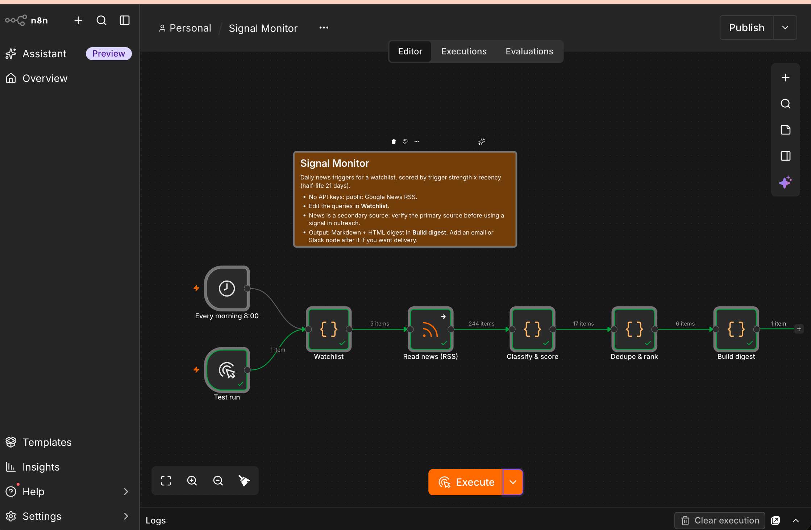

# Signal Monitor (n8n)

The daily, scheduled layer of the [Signal-to-Outreach Engine](../README.md): every morning it reads news for a watchlist, recognises triggers, scores them and builds a digest.

**No API keys.** It uses public Google News RSS feeds.



*A real run: 5 feeds → 244 articles → 17 recognised triggers → 6 new signals above the threshold → 1 digest.*

```
Every morning 8:00 ─┐
                    ├─▶ Watchlist ─▶ Read news (RSS) ─▶ Classify & score ─▶ Dedupe & rank ─▶ Build digest
Test run ───────────┘
```

| Node | What it does |
|---|---|
| **Watchlist** | One Google News query per theme or account. Edit this list. |
| **Read news (RSS)** | Fetches each feed. A failing feed doesn't stop the run. |
| **Classify & score** | Maps headlines to a trigger type (new leader, funding/M&A, AI rollout, hiring, incident, regulation). Score = strength × decay, half-life 21 days. Older than 90 days is dropped. |
| **Dedupe & rank** | Removes duplicate links and the same story from several outlets, remembers across days what it already reported, keeps scores ≥ 30, top 15. |
| **Build digest** | Markdown and HTML table, ready to email or post. |

The scoring rules are the same as in [`engine/scoring.py`](../engine/scoring.py).

## Example

See [`example-digest.md`](example-digest.md): the real output of a test run (5 feeds, ~240 articles read, 16 triggers recognised, 6 above the threshold).

## Run it

1. Start n8n locally: `npx n8n` (needs Node.js), then open http://localhost:5678.
2. **Workflows → Import from file** → `signal-monitor.json`.
3. Click **Test workflow** (uses the *Test run* trigger) and open **Build digest** to see the result.
4. To run daily, activate the workflow. Optional: add an email or Slack node after **Build digest**.

The JavaScript of each Code node is also in [`code/`](code/) so it can be read and reviewed outside n8n.

## Design choices

- **News is a secondary source.** Every signal is labelled "verify the primary source before using in outreach". The monitor finds candidates; it does not decide what goes into a message.
- **Signals decay.** A three-day-old appointment scores far higher than a two-month-old one.
- **No repeats.** Cross-run memory means the digest only shows what's new. (The memory is only used on scheduled runs, so a manual test run always shows the full result.)
- **Keyword rules, not AI.** Transparent and free. An LLM classifier would be more accurate, but needs an API key and a review step.

## Limitations

- Keyword classification misses nuance and produces some false positives.
- Google News headlines are short; the trigger can be wrong until someone reads the article.
- The same story with very different headlines can still appear twice.
- Themes are broad: a "new security leader" query also returns appointments outside your region. Narrow the queries or add accounts.
- Use a modest number of feeds and a daily schedule; this is not a scraper.
